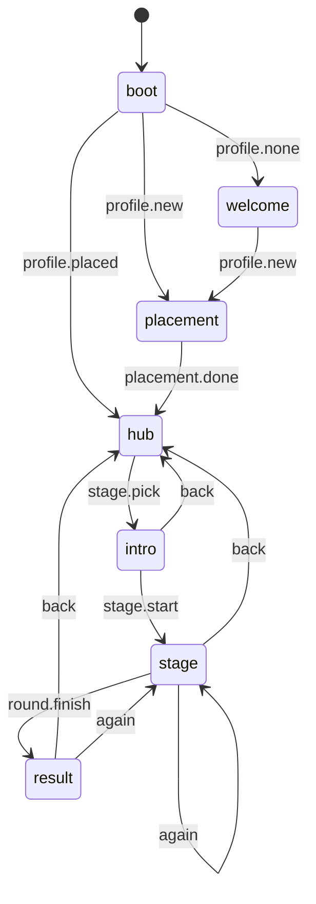
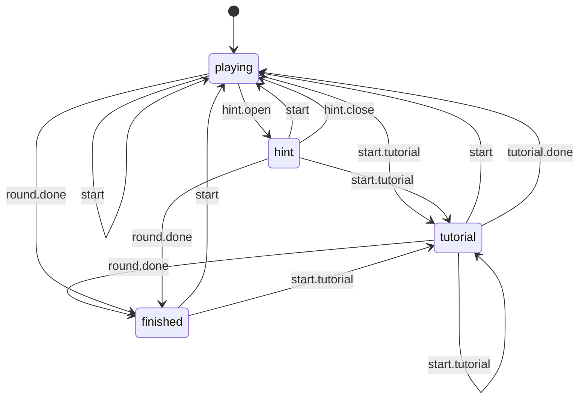
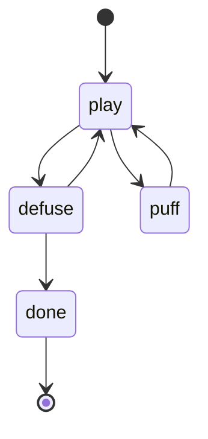
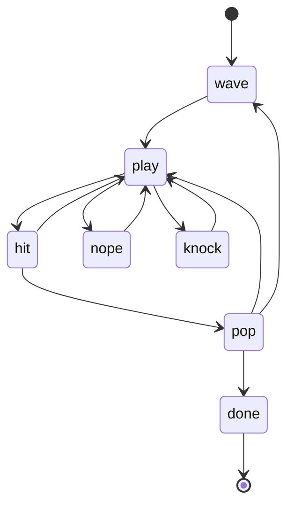
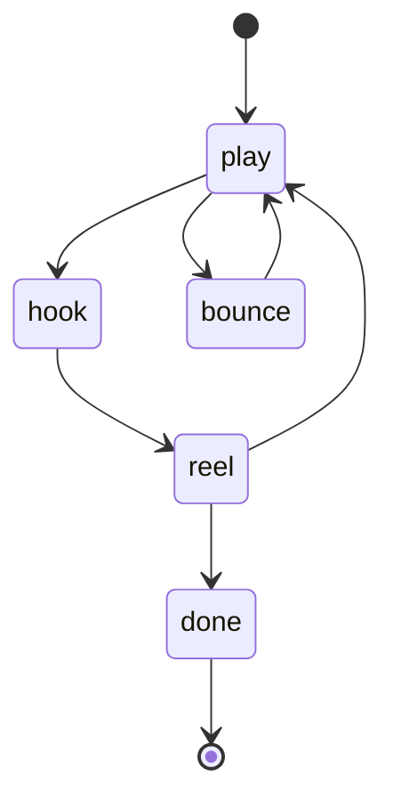
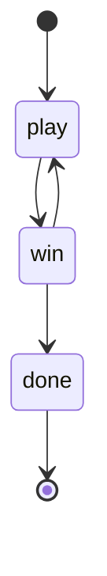
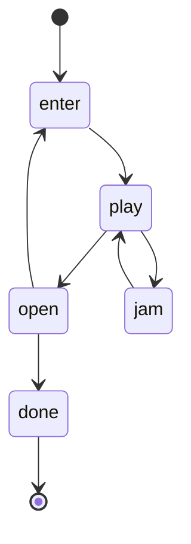
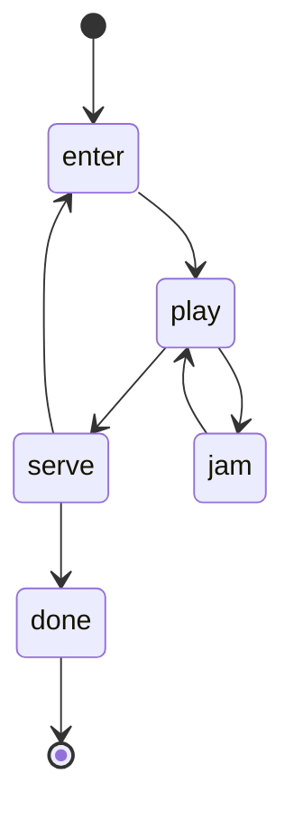
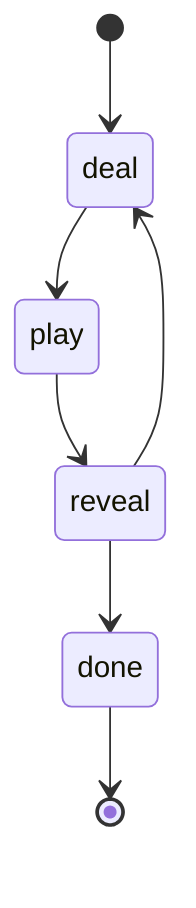
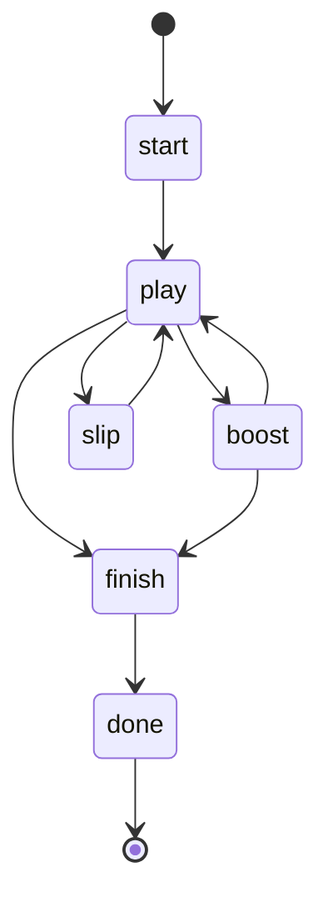

# 상태 머신 (자동 생성 — 직접 고치지 말 것)

`pnpm machines:doc`이 코드의 전이표에서 이 문서를 만든다(`tools/machines-doc.ts`). 표를 고치면 문서·테스트가 따라온다.

- 정의: `src/domain/fsm.ts`(도구), `src/application/machines.ts`(화면·세션), 각 `src/stages/<id>/rules.ts`의 `*_PHASES`(스테이지 단계).
- 강제: `store.go()`는 화면 머신에 없는 이동을 거부, `tests/replay/phases.test.ts`는 놀이 중 일어난 모든 단계 전이가 표에 있는지 확인, `tests/unit/machines.test.ts`는 화면·세션 머신.

## 에이전트·테스트용 빠른 조회

| 무엇 | 어디서 |
|---|---|
| 지금 화면, 갈 수 있는 다음 화면, 스테이지 단계 | 브라우저 콘솔 `__game.snapshot()` |
| 스테이지가 지금 입력을 받는가 | `__stage.info().acceptsInput` (= 단계 표의 `input` + 튜토리얼 잠금 아님) |
| 세션 상태(튜토리얼/놀이/힌트/끝) | DOM `[data-testid=stage]`의 `data-session` 속성 |
| 한 문제 풀기(같은 입력 경로) | `__stage.solveOne()` — `acceptsInput`일 때만 효과 |

## 1. 화면 흐름 (`SCREENS`)

## 2. 스테이지 세션 (`SESSION`)

한 스테이지 안에서의 진행: 무언 튜토리얼 → 놀이 ↔ 힌트 → 끝. 예전의 `tutorial`·`hintOpen`·`locked`·`paused` 불리언을 대신한다.

| 상태 | 입력 잠금 | 시뮬레이션 멈춤(실시간 스테이지) | 힌트 창 |
|---|---|---|---|
| tutorial | 예 | — | — |
| playing | — | — | — |
| hint | — | 예 | 예 |
| finished | 예 | — | — |

## 3. 스테이지 단계

`입력` = 아이의 답을 받는 단계, `연출` = 정해진 틱 뒤 스스로 끝나는 단계.

### ① 폭탄 해체반 (`bomb`)

| 단계 | 입력 | 연출 | 다음 | 설명 |
|---|---|---|---|---|
| play | 예 | — | defuse, puff | cut the wires whose numbers make the target |
| defuse | — | 예 | play, done | right wires: the bomb turns into a gift |
| puff | — | 예 | play | wrong wires: a silly puff, the wires come back |
| done | — | — | — | round over |

### ② 좀비 숫자 막기 (`zombie`)

| 단계 | 입력 | 연출 | 다음 | 설명 |
|---|---|---|---|---|
| wave | — | 예 | play | a new group arrives at the gate |
| play | 예 | — | hit, nope, knock | play a card on the balloon |
| hit | — | 예 | play, pop | the card lands, the number changes |
| nope | — | 예 | play | refused card (would go below 0) |
| pop | — | 예 | play, wave, done | exactly 0: the balloon pops |
| knock | — | 예 | play | the zombie bumps the door and hops back |
| done | — | — | — | round over |

### ③ 숫자 낚시 (`fishing`)

| 단계 | 입력 | 연출 | 다음 | 설명 |
|---|---|---|---|---|
| play | 예 | — | hook, bounce | pick the fish (two for a sum / difference) |
| hook | 예 | — | reel | right catch on the line: wind the reel (taps, never timed) |
| reel | — | 예 | play, done | the catch flies into the bucket |
| bounce | — | 예 | play | wrong pick: the fish puff up and bounce back |
| done | — | — | — | round over |

### ④ 슬라임 합체 (`slime`)

| 단계 | 입력 | 연출 | 다음 | 설명 |
|---|---|---|---|---|
| play | 예 | — | win | merge / split slimes to make the target (undo any time) |
| win | — | 예 | play, done | target made: the slimes celebrate |
| done | — | — | — | round over |

### ⑤ 이상한 자물쇠 방탈출 (`escape`)

| 단계 | 입력 | 연출 | 다음 | 설명 |
|---|---|---|---|---|
| enter | — | 예 | play | room cut: the camera swoops in (hints may already be asked) |
| play | 예 | — | open, jam | open the "?" things, then press a lock key |
| open | — | 예 | enter, done | right key: the door opens |
| jam | — | 예 | play | wrong key: the lock rattles, that key dims |
| done | — | — | — | round over |

### ⑥ 피자 가게 둘이서 (`pizza`)

| 단계 | 입력 | 연출 | 다음 | 설명 |
|---|---|---|---|---|
| enter | — | 예 | play | the customer walks in |
| play | 예 | — | serve, jam | press the pizza key with the answer |
| jam | — | 예 | play | wrong key: the oven puffs / the box spills |
| serve | — | 예 | enter, done | bake or pack, hand over, high-five |
| done | — | — | — | round over |

### ⑦ 숫자 카드 배틀 (`cardbattle`)

| 단계 | 입력 | 연출 | 다음 | 설명 |
|---|---|---|---|---|
| deal | — | 예 | play | cards fly in |
| play | 예 | — | reveal | pick two cards and + / −, then play |
| reveal | — | 예 | deal, done | both plays are compared on the number line |
| done | — | — | — | match over |

### ⑧ 정답 달리기 레이스 (`race`)

| 단계 | 입력 | 연출 | 다음 | 설명 |
|---|---|---|---|---|
| start | — | 예 | play | start lights |
| play | 예 | — | boost, slip, finish | cruising: pick one of the four answers |
| boost | — | 예 | play, finish | right answer: a square (or two) forward |
| slip | — | 예 | play | wrong answer: one second on a banana peel |
| finish | — | 예 | done | across the line |
| done | — | — | — | race over |

## 4. 일부러 암묵적으로 둔 작은 머신

표로 만들면 코드만 늘고 얻는 것이 적어 그대로 둔 것들(찾을 수 있게 목록만 남김):

| 무엇 | 어디 | 상태 | 그대로 둔 이유 |
|---|---|---|---|
| 섬 드래그 | `src/scenes/island/island.ts` | 없음 → 눌림 → 끄는 중 | 한 함수 안의 지역 상태 3개, e2e로 검증 |
| 장면 연출 타이머 | 각 `scene.ts`의 `xxxT`(−1 = 꺼짐), `once()` | 꺼짐 ↔ 재생 중 | 판정과 무관한 장식(P5), 프레임마다 스스로 끝남 |
| 힌트 사다리 | `RoundCore.puzzleHints` 0→4, 4에서 닫으면 새 숫자 | 0..4 | 숫자 하나로 충분, E4 테스트가 지킴 |
| 말풍선 | `SayBubble` 큰 글씨 → 7초 뒤 작게 | 큼 ↔ 작음 | 컴포넌트 지역 상태 |
| 렌더러 | `WorldHost`/`RenderWorld` WebGPU → WebGL2 폴백 → 장치 손실 복구 → 치명 오류 | 4 | 브라우저 이벤트 주도, e2e `engine.spec`이 검증 |
| 저장 | `createSaver` 한가함 → 대기(디바운스) → 저장 중 | 3 | infra 내부, 단위 테스트 있음 |
| 적응 엔진 | `adaptive.ts` 승급/강등/구조 모드 | 레벨 × 연속 기록 | 이미 순수 함수 + 속성 테스트 |
